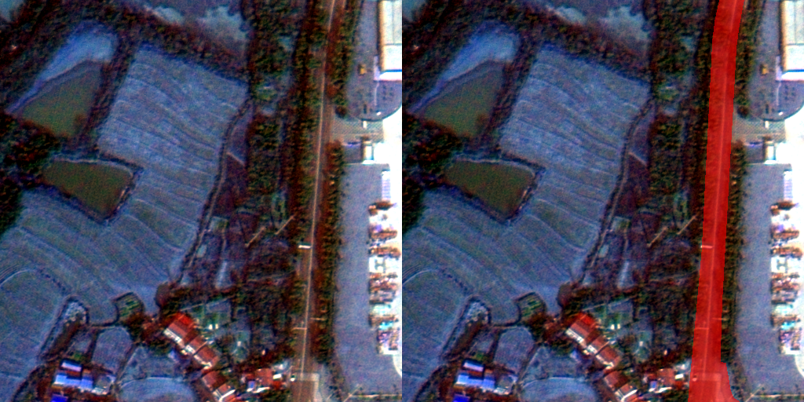
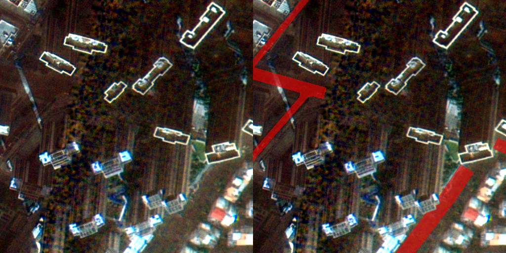
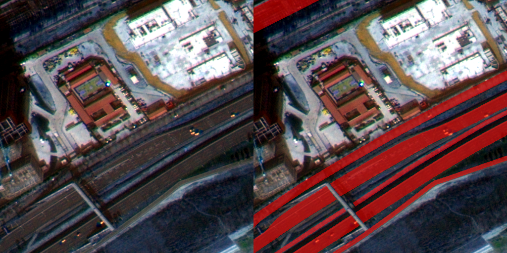
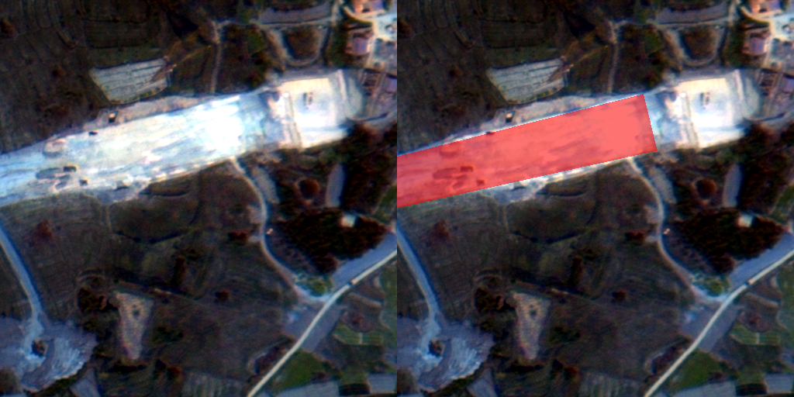

# W1-RoadFormer 当前方案与可提升点

更新日期：2026-11-18。训练仍在进行，文中的本地分数以当时保存的最好权重为准。

这份说明给队友同步用。先写现在已经在跑的方案和分数，再写数据里真正看到的问题。行道树遮挡是其中一个问题，但不是当前最该先改的地方。

## 1. 现在的方案

任务是武汉一号 0.5 米 RGB 影像的道路分割。输入 512×512，输出每个像素两类：0 背景，1 道路。

模型名是 **W1-RoadFormer**。编码器是 SegFormer 的 **MiT-B2**，大约 2735 万参数，已经加载公开的 ImageNet 预训练权重，332 组参数全部对上。解码器把四个尺度的特征对齐后融合，再分成背景和道路。没有加方向卷积、边界辅助头、断线修补和测试时增强。

数据是官方训练集 661 张。影像是 uint16 三通道，掩膜是 uint8，标签只有 0 和 1，文件里没有坐标系。全数据集道路像素平均占 12.9%，没有空掩膜。其中 529 张训练，随机留出 132 张做验证。

归一化不用除以 255。先按训练集各通道的 2% 和 98% 分位数裁剪到 0–1，三个通道大约是 R 363–1196、G 304–1222、B 179–821，然后再做 ImageNet 的均值和方差。增强只有水平翻转、垂直翻转、90° 旋转和 ±10% 亮度。

训练在本机 GTX 1660 SUPER（6 GB）上进行，batch size 为 2，最多 80 轮，使用 float32。这张卡上半精度会把损失变成 nan，所以关掉了。损失是加权交叉熵加 Dice，道路的权重大于背景。学习率 6e-5，编码器因为已经有预训练，学习率是解码器的十分之一。

## 2. 分数怎么看

本地验证集上，已经看到的最好结果是第 17 轮，**mIoU 0.800**。更早的第 6 轮是 mIoU 0.772、道路 IoU 0.617。第 17 轮的道路 IoU 没有单独写进权重文件。

官方榜按百分制显示，只统计官方测试集的 mIoU。截至 11 月 18 日晚，前几名是：

| 排名 | 队伍 | 官方测试集 mIoU |
| --- | --- | --- |
| 1 | ai4seg | 85.02 |
| 2 | nice | 80.21 |
| 3 | 勘探队 | 75.37 |
| 4 | 数绘山河_GeoTrace | 70.98 |

本地 0.800 换成同一写法是 **80.0**。它和榜上第 2 名接近，但这是自己留出的 132 张，不是官方测试集。这 132 张和训练图来自同一批，相邻切片可能被分到两边，所以本地分通常偏高。官方分数低 3 到 8 个点都正常。

现在还没有上榜。`outputs/best.pth` 是本地最好权重。项目根目录的 `pretrained.pth` 仍是训练前的初始权重，不能拿去提交。上榜还要等训练结束，用最好权重复盖 `pretrained.pth`，再用 Docker 打出 `w1-roadformer.tar` 上传。

比赛不只有 mIoU。精度 30 分，效率 20 分，完整性 20 分，创新 20 分，标注 10 分。标注平台已经关闭，这 10 分不要指望用其他平台补标赛题影像来拿回来。

## 3. 数据里实际是什么样

对 661 张掩膜做了连通和宽度统计，并看了几类典型图。左图是百分位拉伸后的影像，右图红色是官方道路标签。

道路主体偏宽。宽度统计的中位数大约 24 个像素，按 0.5 米一个像素，大约 12 米。十分之一最窄的样本也还有大约 6 米。多数不是一两像素的细线，所以“专门补细路连通”不应该排在第一位。

连通性总体是好的。369 张只有 1 块较大的道路区域，115 张有 3 块及以上。多块不一定是树把路遮断了，高架、平行车道、路口分开标也会变成多块。

### 路旁边有树，但路面还在

`img0` 是这种。树在道路左侧形成一条深色边，路面本身连续、清楚。这种图里，树主要干扰道路边缘，不把路截断。模型如果把树荫收进道路，或者把路边裁掉一截，IoU 会掉，但主干不会丢。

### 树冠把路面盖住，标签仍然标成路

`img558` 是这种。红线穿过成片树冠，树下面几乎看不见水泥或沥青，官方掩膜仍把下面标成道路。模型如果只认“看起来像路的像素”，这里就会断。

这种样本说明：标签要的是道路范围，不是“肉眼还能看见的路面”。被树盖住的路，训练时仍然是正样本。

### 阴影、强反光、平行车道

`img520` 里道路很宽，楼房阴影压在路面上，旁边还有平行车道和高架。标签是分开的几条带，中间的隔离和阴影没有被标成路。如果推理后用闭运算或最短路径把断开的地方连上，这几条平行路会被粘在一起，分数会下降。

`img648` 是另一类：路面被晒得发白，纹理几乎没了，标签仍是一条完整的路。这和树挡路相反，是“太亮所以不像路”。当前归一化能压掉一部分极端亮度，但训练里的亮度变化只有 ±10%，覆盖不到这种反光。

另外还有乡间窄路和路口，例如掩膜比最亮的那条路面更宽，把路肩也标进去了。这类误差集中在边缘，不是整条路丢失。

## 4. 行道树遮挡算不算分数低的原因

算一部分原因，但现在不能把它当成主要矛盾。

本地第 17 轮已经到 mIoU 0.800。如果树遮挡大面积把路截断，验证分不会这么快到这个水平。更常见的是路侧的树影响边缘，真正“树冠盖住整条路”的是其中一部分图。

而且要分清两种树：

- 树在路边，路面可见。要解决的是边界，不是把路补连上。
- 树盖在路上，标签仍是道路。要解决的是让模型在看见树冠时仍把该处标成路。

第二种不能靠推理后的形态学修补。闭运算分不清“树下的路”和“不该连接的平行车道”。

## 5. 建议的提升顺序

当前这轮训练先跑完，不要中途改结构。下面按值得做的顺序写。每一项都应该先在同一套 132 张验证图上比 mIoU 和道路 IoU，变好再保留。

1. **先拿到官方测试集分数。** 本地 80.0 还不能和榜上的 85.02、80.21 直接比。差在树、阴影还是验证集泄漏，要等官方数出来才知道该补哪一块。提交本身也是现在唯一能确认排名的办法。

2. **把验证集预测图画出来再改。** 用最好权重把 132 张验证图的预测和标签叠在一起，按下面三类各抽十几张看：树冠盖住路、楼影压住路、路口和平行车道。哪一类错得多，就做对应的那一项，避免同时改三处，最后不知道是谁起了作用。

3. **若树冠盖住的路经常被预测成背景，做遮挡增强。** 训练时从其他图上裁一块树冠，贴到道路区域上面，标签保持为道路。模型被迫学会“这里虽然是树，上下文仍是路”。只改训练，推理不变，也不会把平行车道粘起来。贴的比例建议从小开始，例如 20% 的训练图、每张只盖住一小段路，避免模型干脆把所有树都标成路。

4. **若错误主要在路的边缘，再加一个很轻的边界损失。** 路侧行道树、路肩和建筑物交界属于这一类。边界损失的权重要小，和现在的加权交叉熵加 Dice 比一次。验证 mIoU 没有提高就拿掉，不为了“有边界模块”留着。

5. **若阴影和反光的路经常丢，加强亮度扰动。** 现在只有整图 ±10%。可以改成在道路附近随机压暗或提亮，模拟楼影和路面反光。同样只做训练侧。

6. **效率分单独看。** 平台评测显卡是 A30。MiT-B2 在 512 尺寸上不算小。如果官方 mIoU 已经接近前三，但单张耗时明显落后，再考虑减小推理 batch 或换更小的编码器。在官方分数出来之前，不为了速度把现在这个模型换掉。

## 6. 现在不要做的

- 不要并行再训 D-LinkNet、SegNeXt 或 RemoteCLIP。一个人加当前这张 6 GB 卡，先把这一个模型交上去。
- 不要默认打开闭运算、连通域补洞或最短路径连接。平行车道和高架会被误连。
- 不要因为第 0 张道路只占 6.55% 就加重类别权重。全数据集平均是 12.9%，当前权重已经向道路倾斜。
- 不要把赛题影像拿到其他平台重新标注。既补不回标注分，也有违规风险。
- 不要把 661 张训练图打进 Docker 镜像。镜像里只放代码和训练好的 `pretrained.pth`。
